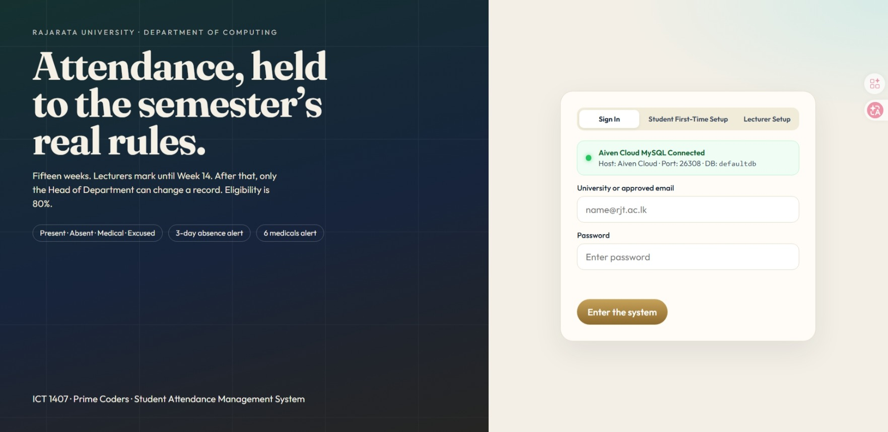
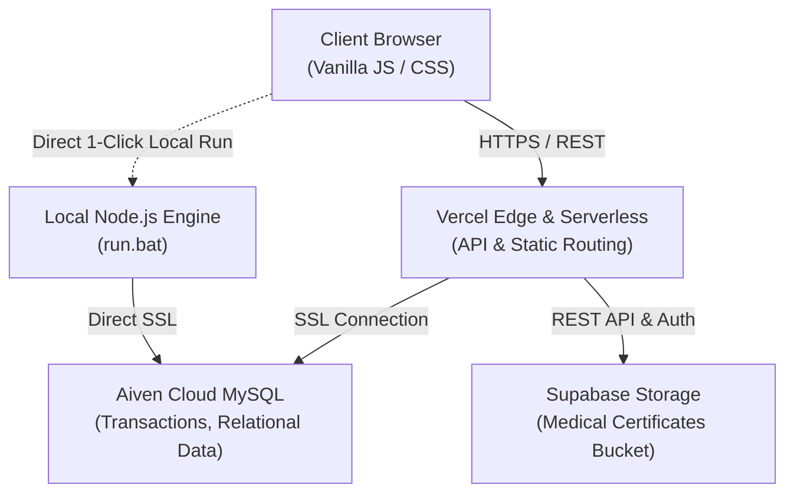

<div align="center">

# 🎓 SAM — Student Attendance Management System
### *Enterprise Academic Attendance, Medical Verification & Eligibility Platform*

[](https://prime-coders-sams.vercel.app/)
[](https://nodejs.org/)
[](https://aiven.io/)
[](https://supabase.com/)
[](LICENSE)

**Developed by Team Prime Coders**  
*Faculty of Applied Sciences · Rajarata University of Sri Lanka*

---

### 🌐 **[Live Production URL: https://prime-coders-sams.vercel.app](https://prime-coders-sams.vercel.app/)**

<br/>

<a href="https://prime-coders-sams.vercel.app/">
  
</a>

<br/>

</div>

---

## 📌 Executive Summary

The **Student Attendance Management System (SAM)** is a full-featured, cloud-native university management application designed to automate, streamline, and protect the academic attendance lifecycle. Built to satisfy strict institutional bylaws (including the **80% exam eligibility criteria**), SAM provides role-tailored dashboards for **Students**, **Lecturers**, the **Head of Department (HOD)**, the **Student Request Committee**, and the **Dean**.

Unlike traditional spreadsheet-based records prone to data corruption, human error, or unmonitored changes, SAM establishes a single source of truth backed by **Aiven Cloud MySQL (SSL)** and **Supabase Object Storage**, accompanied by real-time automated alerts, medical submission workflows, section freeze controls, and an immutable audit log.

---

## 🚀 Key Advantages & Feature Highlights

### 1. 🔒 Verified Student-Only Self-Service Portal
* **Strict Reg-No & Institutional Verification**: Students can only activate and access accounts using their official university registration numbers (e.g. `ICT/2024/xxx`) and authorized university domains (`@rjt.ac.lk`).
* **Strict Privacy Isolation**: Students **only see their own data**. They cannot view other students' records, attendance marks, or medical documents.
* **Real-Time Attendance Gauges**: Instant visual feedback showing percentage attendance, classes attended vs. missed, and projected eligibility.

### 2. 📑 Medical Certificate Submission & Review (Supabase Storage)
* **Direct Student Uploads**: Students can submit medical excuse requests along with digital copies of medical certificates (PDF, JPG, PNG).
* **Cloud Object Storage**: Files are encrypted and uploaded to **Supabase Storage** (`Medicals` bucket), producing tamper-proof CDN URLs.
* **Multi-Tier Committee Workflow**: The Student Request Committee and HOD review evidence directly in the browser and choose to **Accept**, **Reject**, or mark as **Excused**, with automatic recalculation of attendance percentages.

### 3. ⚠️ 80% Eligibility Engine & Automated Warning Alerts
* **University Bylaw Enforcement**: Continuously calculates attendance against the mandatory 80% exam eligibility barrier.
* **Color-Coded Status Thresholds**:
  * 🟢 **Eligible (≥ 80%)**: Full clearance for semester examinations.
  * 🟡 **Warning Zone (70% - 79%)**: Early-warning alerts encouraging immediate recovery.
  * 🔴 **Barred / Critical (< 70%)**: Flagged on both Student and HOD dashboards for intervention.
* **Notice Banners**: Automated alert banners prompt students when their eligibility is at risk.

### 4. 📊 1-Click Official Excel Attendance Sheet Importer
* **Instant Departmental Onboarding**: Import official departmental Excel attendance files (`.xlsx`) directly into the system with zero manual re-entry.
* **Automatic Entity Creation**: In a single click, the parser maps and populates:
  * 7+ Academic Courses & Course Sections
  * Academic Lecturers & Demonstrators
  * 120+ Enrolled Students
  * 5,280+ Weekly Attendance Records across all 11+ weeks

### 5. ❄️ Anti-Tamper Section Freezing
* **Prevent Retroactive Alterations**: The HOD or Coordinator can "Freeze" any course section once attendance is finalized.
* **Lecturer Editing Lock**: When frozen, lecturers cannot add, remove, or modify attendance records, eliminating unauthorized grade modifications.
* **Administrative Override**: Only the Head of Department maintains security clearance to unfreeze or make authorized corrections.

### 6. 📅 Academic Calendar & Semester Lifecycle Control
* **"Move the Week"**: Advancing the current teaching week automatically updates course schedules, opens new attendance recording sheets for lecturers, and locks retrospective past weeks.
* **"Open Next Semester"**: Seamlessly archive the active academic semester, preserve historical student records, and roll over to a fresh semester with new modules.
* **Week-14 Lecturer Cutoff**: System automatically locks lecturer editing rights after Week 14 to allow exam board preparation.

### 7. 🕵️ Immutable HOD Activity & Audit Trail
* **Complete System Accountability**: The HOD portal features a live feed of **Recent Actions**.
* **Audit Logging**: Every sensitive operation—such as marking attendance, approving medicals, student account creation, section freezing, or grade adjustments—is timestamped and tagged with the user's role and email address.

---

## 👥 Role-Based Portals & Capabilities

| Feature / Permission | 🎓 Student | 👩‍🏫 Lecturer | 🏛️ Head of Dept (HOD) | 📋 Committee | 🎓 Dean |
| :--- | :---: | :---: | :---: | :---: | :---: |
| View Personal Attendance & Stats | ✅ | — | — | — | — |
| Submit Medical Certificates | ✅ | — | — | — | — |
| Mark Attendance for Assigned Classes | — | ✅ | ✅ (Any) | — | — |
| View Assigned Course Roster | — | ✅ | ✅ | — | ✅ |
| Freeze / Unfreeze Course Sections | — | — | ✅ | — | — |
| Advance Teaching Week | — | — | ✅ | — | — |
| Open New Academic Semester | — | — | ✅ | — | — |
| Import Departmental Excel Workbook | — | — | ✅ | — | — |
| Review & Approve Medical Requests | — | — | ✅ | ✅ | — |
| View Complete Faculty Audit Trail | — | — | ✅ | — | ✅ |
| Faculty-Wide Eligibility Analytics | — | — | ✅ | — | ✅ |

---

## 🏗️ System Architecture



* **Frontend**: Ultra-fast Vanilla JavaScript and bespoke modern CSS with glassmorphism and modern typography (zero bulky framework overhead).
* **Backend**: Node.js modular serverless architecture (`api/index.js` + `sam/server.js`).
* **Database**: Managed **Aiven Cloud MySQL** with SSL encryption (`rejectUnauthorized: false`).
* **File Storage**: **Supabase Object Storage** for encrypted student medical records.
* **Hosting**: **Vercel Edge Network** with continuous deployment from GitHub.

---

## 🛠️ Tech Stack & Libraries

* **Core Runtime**: [Node.js](https://nodejs.org/) (ES Modules)
* **Frontend**: HTML5, Vanilla JavaScript (ES6+), Modern Custom CSS (Google Fonts: *Outfit*, *Fraunces*)
* **Cloud Database**: [Aiven Cloud MySQL](https://aiven.io/mysql) + `mysql2/promise`
* **Cloud Storage**: [Supabase Storage](https://supabase.com/storage) REST API
* **Data Processing**: [`xlsx`](https://www.npmjs.com/package/xlsx) for high-performance spreadsheet parsing
* **Hosting**: [Vercel](https://vercel.com/) Serverless Functions

---

## ⚡ Getting Started Locally

### Prerequisites
* [Node.js (v18 or higher)](https://nodejs.org/)
* Git

### Option 1: One-Click Start (Windows)
1. Clone the repository:
   ```bash
   git clone https://github.com/Pabasaralakmal2/Prime-Coders---SAMS.git
   cd Prime-Coders---SAMS
   ```
2. Double-click **`run.bat`**.
   * It will automatically detect missing packages, run `npm install`, start the server, and launch your browser at `http://localhost:8080`!

### Option 2: Manual Terminal Setup
```bash
# 1. Clone repository
git clone https://github.com/Pabasaralakmal2/Prime-Coders---SAMS.git
cd Prime-Coders---SAMS

# 2. Install dependencies
npm install

# 3. Start local development server
npm start
```
Open **`http://localhost:8080`** in your browser.

---

## 🔑 Demo Login Accounts

| Role | Email | Password | Description |
| :--- | :--- | :--- | :--- |
| **Head of Department** | `hod@rjt.ac.lk` | `prime123` | Full administrative controls, import Excel, freeze, move week |
| **Lecturer** | `lecturer@rjt.ac.lk` | `prime123` | Mark and edit attendance for assigned courses |
| **Student** | `s.perera@rjt.ac.lk` | `prime123` | View personal attendance, stats, submit medicals |
| **Committee Member** | `committee@rjt.ac.lk` | `prime123` | Review and recommend medical excuse submissions |
| **Dean** | `dean@rjt.ac.lk` | `prime123` | High-level faculty overview and eligibility reports |

*(New students can also click **"First time logging in? Activate account"** and register with any imported `ICT/2024/xxx` registration number!)*

---

## 🛡️ Security & Privacy Standards
* **Zero Plaintext Secrets in Git**: Sensitive credentials are managed strictly via environment variables.
* **Cryptographic Passwords**: Passwords salted and hashed with SHA-256 via Node's native `crypto` module.
* **Role-Based Middlewares**: Server-side route validation guarantees that users cannot invoke unauthorized endpoints.
* **Input Sanitization**: Strict input validation prevents SQL injection and cross-site scripting.

---

## 👨‍💻 Team Prime Coders
Developed with ❤️ by **Team Prime Coders** for Rajarata University of Sri Lanka.

*Contributions and pull requests are warmly welcomed.*
